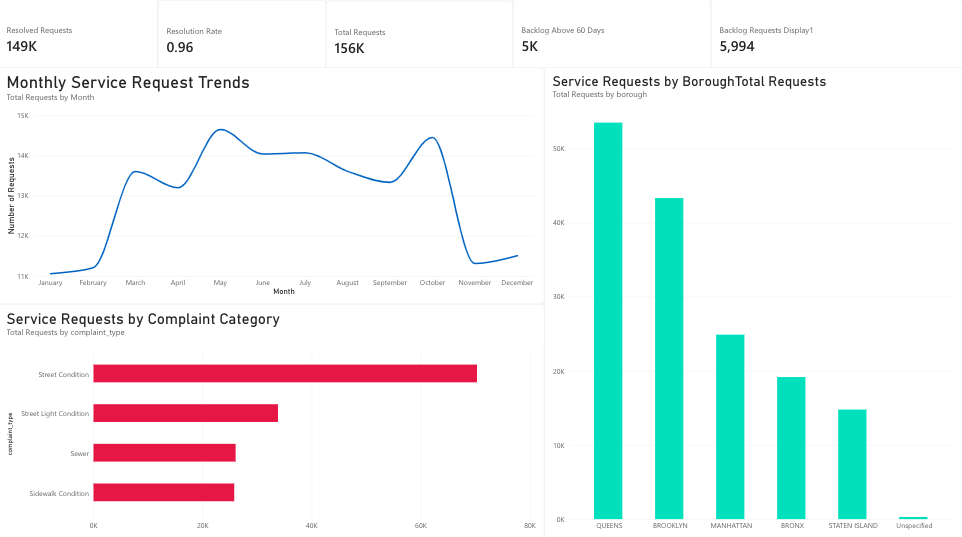

# Urban-Infrastructure-Service-Intelligence
A Data-Driven Analysis of Municipal Maintenance Requests, Service Resolution, and Geographic Hotspots
# Urban Infrastructure Service Intelligence

### A Data-Driven Approach to Municipal Maintenance and Operational Efficiency

## 1. Project Overview

Urban Infrastructure Service Intelligence is a data analytics and business intelligence project focused on analyzing municipal service requests in New York City.

The project uses NYC 311 service request data to understand infrastructure-related complaints, identify geographic hotspots, evaluate service resolution performance, and analyze unresolved requests.

The analysis focuses on four major infrastructure categories: Street Condition, Street Light Condition, Sewer, and Sidewalk Condition.

Using Python, SQL, Excel, and Power BI, the project transforms raw municipal service request data into actionable insights that can help city authorities improve maintenance planning, allocate resources effectively, and reduce unresolved service requests.

## 2. Business Problem

Urban infrastructure plays an important role in public safety, transportation, sanitation, and quality of life. However, city authorities regularly receive thousands of complaints related to damaged streets, streetlights, sewer problems, and sidewalk conditions.

Managing these complaints efficiently can be challenging because of the large volume of requests, differences in resolution times, geographic concentration of complaints, and the accumulation of unresolved requests.

Without proper data analysis, authorities may struggle to identify high-demand locations, understand service delays, and prioritize maintenance activities.

This project addresses these challenges by analyzing historical 311 service request data and developing a business intelligence solution to support data-driven municipal decision-making.

## 3. Project Objectives

The main objectives of this project are to:

- Analyze the volume and distribution of infrastructure-related service requests.
- Identify the most frequently reported infrastructure problems.
- Examine monthly complaint trends and changes in request volume.
- Compare service request patterns across NYC boroughs.
- Evaluate average and median resolution times.
- Identify unresolved requests and analyze backlog aging.
- Identify ZIP codes with high complaint volumes.
- Evaluate agency-level service performance.
- Detect data quality issues that may affect analytical results.
- Develop an interactive Power BI dashboard for operational monitoring.

## 4. Dataset and Data Sources

The project uses the publicly available NYC 311 Service Requests dataset from NYC Open Data.

Dataset: 311 Service Requests from 2020 to Present

Source: NYC Open Data

Dataset link: [https://data.cityofnewyork.us/Social-Services/311-Service-Requests-from-2020-Present/erm2-nwe9](https://data.cityofnewyork.us/Social-Services/311-Service-Requests-from-2020-Present/erm2-nwe9?utm_source=chatgpt.com)

Analysis period: January 2025 – December 2025

The analysis focuses on four infrastructure-related complaint categories:

- Street Condition
- Street Light Condition
- Sewer
- Sidewalk Condition

The selected dataset contains 156,034 service request records and 12 original columns.

## 5. Technology Stack

| Technology       | Purpose                                                    |
| ---------------- | ---------------------------------------------------------- |
| Python           | Data cleaning, transformation, validation, and analysis    |
| Pandas           | Data manipulation and preprocessing                        |
| SQLite           | Database storage and SQL analysis                          |
| SQL              | Business queries, aggregations, and performance analysis   |
| Excel            | Data inspection and supporting analysis                    |
| Power BI Service | Interactive dashboards and business intelligence reporting |
| GitHub           | Project documentation and portfolio presentation           |

## 6. Project Methodology

The project follows a structured data analytics workflow, beginning with data collection and ending with business recommendations.

### Step 1: Data Collection

The NYC 311 Service Requests dataset was collected from NYC Open Data. Records were filtered to include infrastructure-related complaints from January to December 2025.

### Step 2: Data Cleaning and Preparation

Python and Pandas were used to clean and prepare the dataset for analysis.

The preparation process included:

- Selecting relevant columns.
- Filtering the four infrastructure complaint categories.
- Converting date columns into appropriate datetime formats.
- Checking missing values.
- Identifying duplicate request IDs.
- Standardizing relevant fields.
- Calculating resolution duration.
- Calculating backlog age.
- Creating additional analytical columns.

The following calculated columns were created:

| Column                  | Purpose                                                            |
| ----------------------- | ------------------------------------------------------------------ |
| resolution_days         | Measures the time taken to resolve a request                       |
| backlog_age_days        | Measures how long an unresolved request has remained open          |
| backlog_aging           | Groups backlog requests into aging categories                      |
| invalid_resolution_time | Identifies negative resolution durations                           |
| valid_resolution_days   | Excludes invalid durations from resolution-time analysis           |
| status_date_mismatch    | Identifies inconsistencies between request status and closure date |
| is_resolved             | Identifies requests with Closed status                             |
| is_unresolved           | Identifies requests without Closed status                          |
| is_backlog              | Identifies requests without a closure date                         |

### Step 3: Database Creation

The cleaned dataset was imported into SQLite and stored in a table named `service_requests`.

SQL was used to perform aggregations, calculate service performance metrics, identify complaint hotspots, and analyze backlog distribution.

### Step 4: SQL Analysis

Multiple SQL queries were developed to answer important business questions, including complaint volume, monthly trends, resolution performance, agency performance, borough-level distribution, backlog aging, and data quality validation.

### Step 5: Power BI Dashboard Development

The processed analytical results and cleaned dataset were used to develop a five-page interactive Power BI dashboard.

The dashboard provides an overview of service request performance, complaint trends, resolution efficiency, geographic hotspots, and data quality.

## 7. Business Questions

The project aims to answer the following business questions:

1. Which infrastructure complaint categories receive the highest number of service requests?
2. Which boroughs generate the highest complaint volumes?
3. How does complaint volume change throughout the year?
4. Which months experience the highest and lowest request volumes?
5. Which complaint categories have the longest resolution times?
6. What percentage of service requests are successfully resolved?
7. How many requests remain unresolved?
8. How old are the unresolved service requests?
9. Which boroughs have the largest unresolved backlogs?
10. Which ZIP codes report the highest number of infrastructure complaints?
11. How does service performance differ between responsible agencies?
12. What data quality issues could affect the reliability of the analysis?

## 8. Key Analytical Findings

### 8.1 Complaint Volume Analysis

A total of 156,034 infrastructure-related service requests were analyzed.

| Complaint Category     | Requests | Percentage |
| ---------------------- | -------- | ---------- |
| Street Condition       | 70,330   | 45.07%     |
| Street Light Condition | 33,835   | 21.68%     |
| Sewer                  | 26,062   | 16.70%     |
| Sidewalk Condition     | 25,807   | 16.54%     |
| Total                  | 156,034  | 100%       |

Street Condition represents the largest complaint category, accounting for approximately 45% of all requests.

Street Condition and Street Light Condition together represent approximately 66.75% of total requests.

This indicates that road maintenance and street lighting are major areas of public infrastructure service demand.

### 8.2 Borough-Level Analysis

| Borough       | Requests | Percentage |
| ------------- | -------- | ---------- |
| Queens        | 53,530   | 34.31%     |
| Brooklyn      | 43,337   | 27.77%     |
| Manhattan     | 24,905   | 15.96%     |
| Bronx         | 19,181   | 12.29%     |
| Staten Island | 14,787   | 9.48%      |
| Unspecified   | 294      | 0.19%      |

Queens recorded the highest number of service requests, followed by Brooklyn.

Together, Queens and Brooklyn account for approximately 62.08% of the total complaint volume.

These results identify areas with high reported service demand. However, complaint volume alone does not establish that infrastructure conditions are worse in those boroughs. Population, road length, infrastructure coverage, and reporting behaviour should also be considered.

### 8.3 Monthly Complaint Trends

| Month     | Requests |
| --------- | -------- |
| January   | 11,062   |
| February  | 11,208   |
| March     | 13,605   |
| April     | 13,196   |
| May       | 14,648   |
| June      | 14,037   |
| July      | 14,066   |
| August    | 13,606   |
| September | 13,332   |
| October   | 14,447   |
| November  | 11,317   |
| December  | 11,510   |

May recorded the highest complaint volume, with 14,648 requests, while January recorded the lowest, with 11,062 requests.

The largest month-over-month increase occurred in March, at approximately 21.39%. The largest decrease occurred in November, at approximately 21.67%.

These variations can help authorities understand changes in service demand and plan maintenance resources accordingly.

### 8.4 Resolution Performance Analysis

| Complaint Category     | Resolved Requests | Resolution Rate | Average Resolution Days |
| ---------------------- | ----------------- | --------------- | ----------------------- |
| Street Condition       | 66,847            | 95.05%          | 2.89                    |
| Street Light Condition | 31,503            | 93.11%          | 28.92                   |
| Sewer                  | 25,066            | 96.18%          | 2.73                    |
| Sidewalk Condition     | 25,784            | 99.91%          | 11.97                   |

Sidewalk Condition recorded the highest resolution rate, while Street Light Condition recorded the lowest.

Street Light Condition also had the longest average resolution time, at approximately 28.92 days.

This suggests that streetlight-related complaints may require additional operational attention and investigation into maintenance workflows.

### 8.5 Average vs. Median Resolution Time

| Complaint Category     | Average Days | Median Days |
| ---------------------- | ------------ | ----------- |
| Street Condition       | 2.89         | 1.08        |
| Street Light Condition | 28.92        | 9.24        |
| Sewer                  | 2.73         | 0.21        |
| Sidewalk Condition     | 11.97        | 7.87        |

Street Light Condition has a substantial difference between average and median resolution time.

This indicates that some requests take considerably longer to resolve and increase the overall average.

Using both average and median provides a more complete understanding of service performance than relying on average resolution time alone.

### 8.6 Backlog Aging Analysis

A total of 5,994 requests had no recorded closure date.

| Backlog Age   | Requests |
| ------------- | -------- |
| 0–7 Days      | 143      |
| 8–30 Days     | 360      |
| 31–60 Days    | 409      |
| Above 60 Days | 5,082    |
| Total         | 5,994    |

Approximately 84.78% of the backlog requests were older than 60 days as of the fixed reference date of January 1, 2026.

This represents a significant backlog concentration in older unresolved requests.

The findings suggest that authorities should prioritize aging requests and investigate the operational reasons behind prolonged resolution times.

### 8.7 Borough-Level Backlog Analysis

| Borough       | Total Backlog | Above 60 Days | Above 60 Days % |
| ------------- | ------------- | ------------- | --------------- |
| Queens        | 3,264         | 2,859         | 87.59%          |
| Manhattan     | 918           | 787           | 85.73%          |
| Brooklyn      | 805           | 603           | 74.91%          |
| Bronx         | 661           | 553           | 83.66%          |
| Staten Island | 327           | 268           | 81.96%          |
| Unspecified   | 19            | 12            | 63.16%          |

Queens accounts for approximately 54.45% of the total backlog.

It also has 2,859 requests older than 60 days.

These results suggest that Queens should receive particular attention when planning backlog reduction activities.

### 8.8 Agency Performance Analysis

| Agency | Total Requests | Resolved Requests | Resolution Rate | Backlog |
| ------ | -------------- | ----------------- | --------------- | ------- |
| DOT    | 129,972        | 124,134           | 95.51%          | 5,004   |
| DEP    | 26,062         | 25,066            | 96.18%          | 990     |

DOT handles the majority of requests, primarily because of the larger volume of street and streetlight complaints.

DEP recorded a slightly higher resolution rate than DOT.

However, direct agency efficiency comparisons should be interpreted carefully because the agencies handle different complaint types and operational workloads.

### 8.9 Geographic Hotspot Analysis

The ZIP codes with the highest service request volumes include:

| ZIP Code | Borough       | Requests |
| -------- | ------------- | -------- |
| 10314    | Staten Island | 2,668    |
| 10306    | Staten Island | 2,171    |
| 11101    | Queens        | 2,122    |
| 11385    | Queens        | 2,120    |
| 11234    | Brooklyn      | 2,104    |
| 10312    | Staten Island | 2,070    |

These locations represent areas with high reported complaint volumes.

Identifying such hotspots can help authorities prioritize inspections and maintenance planning.

However, high complaint volume should not automatically be interpreted as evidence of worse infrastructure conditions without additional contextual data.

## 9. Data Quality and Validation

Data quality validation was performed to identify inconsistencies and potential limitations.

| Validation Check              | Result  |
| ----------------------------- | ------- |
| Total Records                 | 156,034 |
| Duplicate Request IDs         | 0       |
| Missing Closure Dates         | 5,994   |
| Status-Date Mismatches        | 840     |
| Negative Resolution Durations | 833     |

### Key Data Quality Observations

Duplicate Records: No duplicate request IDs were identified.

Missing Closure Dates: A total of 5,994 records had no closure date. These records were treated as backlog requests for the backlog analysis.

Status-Date Mismatches: A total of 840 records had a non-Closed status despite having a recorded closure date. These inconsistencies were retained and disclosed rather than silently modified.

Negative Resolution Durations: A total of 833 records had negative resolution durations. These records were excluded from valid resolution-time calculations but retained in complaint-volume analysis.

These validation checks help improve transparency and prevent misleading conclusions.

## 10. Power BI Dashboard

The Power BI report contains five analytical pages designed to support municipal infrastructure monitoring and operational decision-making.

### Page 1: Executive Overview

This page provides a high-level summary of infrastructure service request performance through KPI cards and visualizations.

It includes total requests, resolved requests, resolution rate, backlog requests, backlog above 60 days, monthly request trends, complaint category distribution, borough-level distribution, and backlog aging.

### Page 2: Complaint and Trend Analysis

Insert Complaint and Trend Analysis dashboard screenshot here

Suggested file: `images/page2-complaint-trend-analysis.png`

This page focuses on complaint patterns and changes in service demand over time.

It includes monthly complaint trends, complaint category comparisons, monthly trends by complaint category, category distribution by borough, and monthly complaint volume analysis.

### Page 3: Resolution and Backlog Analysis

Insert Resolution and Backlog Analysis dashboard screenshot here

Suggested file: `images/page3-resolution-backlog-analysis.png`

This page evaluates operational efficiency and unresolved service requests.

It includes average versus median resolution time, resolution rates by complaint category, backlog aging distribution, borough-level backlog, and agency-level performance.

### Page 4: Geographic Hotspot Analysis

Insert Geographic Hotspot Analysis dashboard screenshot here

Suggested file: `images/page4-geographic-hotspot-analysis.png`

This page identifies geographic areas with high complaint volumes.

It includes the top 10 ZIP codes by service requests, complaint hotspots by borough, and complaint category distribution across the top 10 ZIP codes.

A geographic map visual was not included because the available Power BI environment restricted the use of Azure Maps. Alternative chart-based hotspot analysis was used instead.

### Page 5: Data Quality and Validation

Insert Data Quality and Validation dashboard screenshot here

Suggested file: `images/page5-data-quality-validation.png`

This page provides transparency into the reliability of the dataset.

It includes request status distribution, missing closure dates, status-date mismatches, negative resolution durations, and duplicate request ID validation.

## 11. Business Recommendations

Based on the analysis, the following recommendations can help improve municipal infrastructure service operations.

1\. Prioritize Aging Backlog Requests

Since approximately 84.78% of backlog requests were older than 60 days, authorities should introduce a priority-based resolution system for long-pending complaints.

2\. Improve Streetlight Maintenance Operations

Street Light Condition complaints have the longest average resolution time. Authorities should investigate operational bottlenecks, maintenance scheduling, spare-part availability, and contractor response times.

3\. Focus on High-Demand Boroughs

Queens and Brooklyn account for a substantial proportion of service requests. Maintenance resources should be allocated based on complaint demand, infrastructure coverage, and population-adjusted indicators.

4\. Strengthen Monthly Resource Planning

Monthly complaint trends can help authorities anticipate changes in service demand and allocate personnel and maintenance resources more effectively.

5\. Monitor Agency Performance

Agency-level dashboards should track resolution rates, backlog size, average resolution time, and aging requests to support operational monitoring.

6\. Improve Data Quality Controls

Automated validation should identify missing closure dates, status-date inconsistencies, and invalid resolution durations before data is used for reporting.

7\. Introduce Geographic Prioritization

High-volume ZIP codes should receive additional inspection and maintenance attention, supported by population and infrastructure-based comparisons.

## 12. Project Limitations

The analysis has several limitations that should be considered when interpreting the findings.

- Complaint volumes represent reported service requests and may not represent the actual condition of infrastructure.
- Population, road length, and infrastructure coverage were not incorporated into the geographic comparisons.
- Missing closure dates may affect backlog and resolution analysis.
- Status-date mismatches and negative resolution durations indicate inconsistencies in the source data.
- Average resolution time may be influenced by unusually long-running cases.
- Geographic map visualization was restricted by the available Power BI environment.
- The dataset represents a historical reporting period and should not be interpreted as live operational information.
- Backlog aging was calculated using January 1, 2026, as the fixed reference date.

## 13. How to Reproduce the Analysis

1. Download the NYC 311 Service Requests dataset from NYC Open Data.
2. Filter the dataset for the selected infrastructure complaint categories and analysis period.
3. Use Python and Pandas to clean, transform, and validate the records.
4. Calculate resolution duration, backlog age, and other analytical fields.
5. Import the cleaned dataset into SQLite.
6. Execute the SQL queries to reproduce the business analysis.
7. Export the SQL results as CSV files.
8. Import the cleaned dataset and analytical results into Power BI.
9. Recreate the five dashboard pages to explore the findings.

## 14. Conclusion

The Urban Infrastructure Service Intelligence project demonstrates how public-sector service request data can be transformed into meaningful business intelligence.

The analysis of 156,034 NYC 311 service requests identified major infrastructure complaint categories, geographic concentrations, monthly demand patterns, resolution performance differences, and a significant concentration of aging unresolved requests.

The findings highlight the importance of backlog management, improved streetlight maintenance operations, geographic resource allocation, and data quality monitoring.

By combining Python, SQL, Excel, and Power BI, this project provides a structured approach to municipal infrastructure analytics and demonstrates practical skills in data preparation, database querying, KPI development, business analysis, and dashboard reporting.

## 15. Future Scope

Future improvements could include:

- Integrating population and road-network data for normalized geographic comparisons.
- Developing interactive geographic maps when the required Power BI mapping capability is available.
- Adding predictive models to forecast complaint volumes.
- Building a backlog risk scoring system.
- Analyzing contractor-level performance and maintenance costs.
- Integrating real-time service request data for continuous monitoring.

Project Category: Business Intelligence | Data Analytics | Smart Cities | Public Infrastructure

Tools Used: Python, Pandas, SQL, SQLite, Excel, Power BI, GitHub

Dataset Source: NYC Open Data – 311 Service Requests

Analysis Period: January 2025 – December 2025
